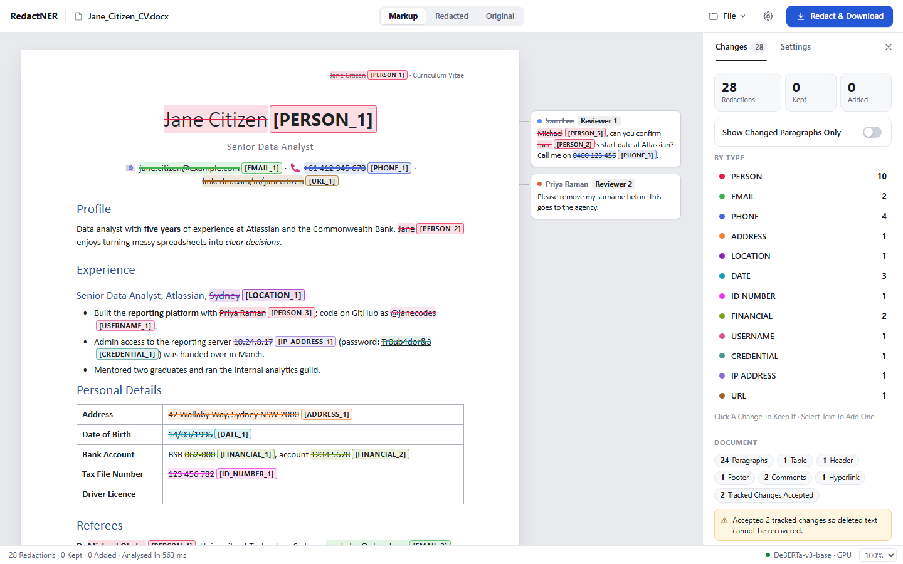
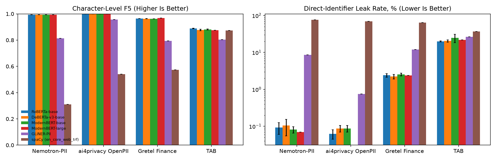
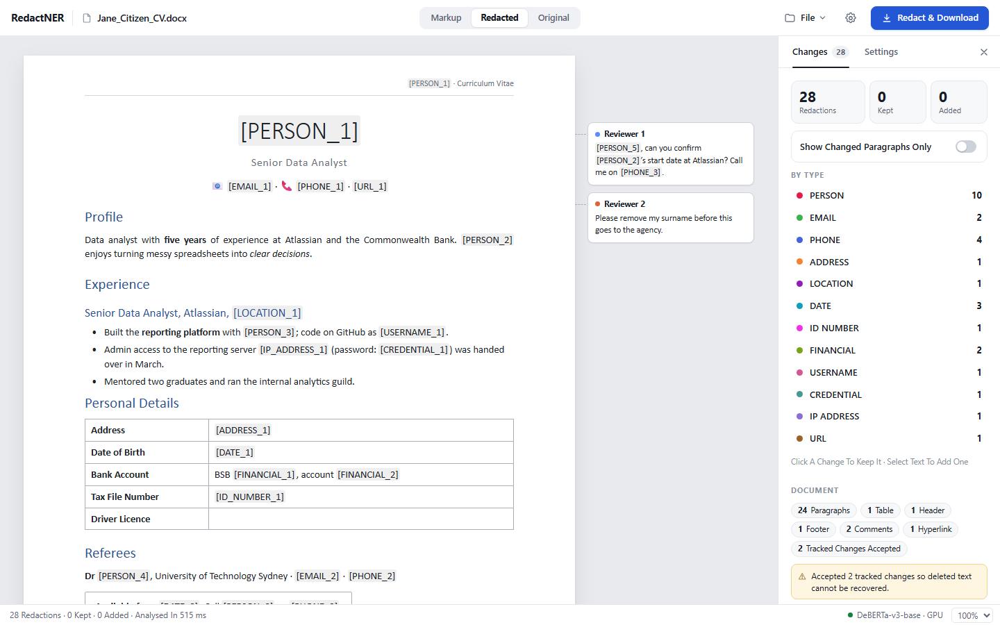

# RedactNER

**Context-aware redaction of personal information in Microsoft Word documents, running entirely on your own machine.**


[](LICENSE)



## Overview

RedactNER finds and removes personally identifiable information (PII) from `.docx` files. A fine-tuned transformer model detects names, contact details, addresses, government and financial identifiers, credentials and more, and a document engine writes each replacement inside the original Word structure. The redacted file therefore keeps its formatting and opens normally in Word.

Everything runs locally. Documents are never uploaded to an external service, so the tool can be used on material that cannot leave the organisation.

## Features

- **Context-Aware Detection.** A fine-tuned DeBERTa-v3 token classifier recognises 13 categories of personal information from the surrounding sentence rather than from fixed word lists, so ambiguous words such as names that are also months or places are judged in context.
- **Recall-First Decisions.** The decision threshold is tuned on held-out data to count a missed identifier far more heavily than an extra redaction, and it can be adjusted in the app.
- **Complete Document Coverage.** Body text, tables, headers and footers, footnotes and endnotes, comments and their authors, text boxes, hyperlink targets, field codes, tracked changes and document properties.
- **Formatting Preserved.** Replacements are written into the original text runs, so fonts, styles, tables and layout are unchanged.
- **Review Before Export.** Every detection can be inspected, kept or removed, and missed text can be added by selecting it.
- **Verified Output.** Before a file is returned, every part of the package is scanned again to confirm that no redacted value remains, and an audit report summarises the changes.
- **Two Redaction Styles.** Consistent labels such as `[PERSON_1]` keep the document readable; fixed-width blocks hide the length of each value.
- **Three Interfaces.** A browser application, a command-line tool and a Python API.

## How It Works

1. **Read.** The `.docx` package is opened with strict safety limits. Encrypted, macro-enabled and malformed files are refused, tracked changes are accepted, and every paragraph is mapped to the exact Word runs that hold its text.
2. **Detect.** The fine-tuned model reads the document text in overlapping 512-token windows and flags every token whose probability of being personal information passes a decision threshold tuned on held-out data. Words are redacted whole, so no fragment of a name is left behind.
3. **Redact.** Each item is replaced inside its original runs. Hyperlinks, field codes, comment authors, document properties and the embedded preview image are cleaned at the same time.
4. **Verify.** All XML parts of the output are scanned for any remaining value before the document is saved.

## Detected Categories

| Category | Examples |
|---|---|
| Person | Full names, first and last names, initials |
| Email | Email addresses |
| Phone | Mobile, landline and fax numbers, Australian and international |
| Address | Street addresses, unit and building numbers, postcodes |
| Location | Cities, suburbs, states, coordinates |
| Date | Dates of birth and other personal dates |
| ID Number | Tax file, Medicare, passport, licence, social security, employee and customer numbers |
| Financial | Card numbers, bank accounts, BSB, IBAN, SWIFT/BIC |
| Username | Account names and handles |
| Credential | Passwords, PINs, security codes, API keys |
| IP Address | IPv4, IPv6 and MAC addresses |
| URL | Personal web addresses and profile links |
| Organisation | Employer and company names (optional, off by default) |

Terms that must always be removed, such as a project codename, and terms that must always be kept can be supplied at run time.

## Data

| Split | Sources | Documents |
|---|---|---|
| Training | Nemotron-PII (30,000), ai4privacy OpenPII in English (20,000), Gretel Finance in English (10,000), synthetic forms (3,000) | 63,000 |
| Development | Nemotron-PII, ai4privacy OpenPII and Gretel Finance, held out from training | 2,750 |
| Test | Nemotron-PII (1,000), ai4privacy OpenPII (1,000), Gretel Finance (1,000) and the Text Anonymization Benchmark (127 court judgments) | 3,127 |

- **One taxonomy.** The corpora use different label schemes, which are mapped onto the 13 categories above with consistent span boundaries.
- **No overlap between training and test.** Test documents that duplicate a training document, exactly or nearly (MinHash similarity of at least 0.8 over word 5-grams), are removed. Fewer than 1 % of the test documents share a template with any training document.
- **Targeted augmentation.** In a fifth of the training documents, names, phone numbers, addresses, places and dates are replaced with Australian-format values. Person names are written in capitals or lower case in another 4 %. The synthetic forms pair field labels such as *TFN* or *BSB* with their values, so the model learns to redact the value but not the label.
- **A real-world test set.** The Text Anonymization Benchmark (TAB) contains judgments of the European Court of Human Rights annotated by legal experts. It is never used for training or tuning and is the only test set written by people rather than generated.

## Results

Four transformer encoders were fine-tuned on the same training set with an identical recipe, apart from memory-saving optimiser settings for the largest: RoBERTa-base, DeBERTa-v3-base and ModernBERT-base with two random seeds each, and ModernBERT-large with one. Each model's decision threshold was tuned on the development set, and the architecture with the best development score, DeBERTa-v3-base, was selected before any test set was scored. Two off-the-shelf systems are included for comparison: GLiNER-PII, a zero-shot PII detector, and spaCy's general-purpose transformer model for named entities. The prototype checkpoint, trained on a smaller set without Gretel Finance or augmentation, is shown for reference.

The **leak rate** is the share of personal-information mentions with any letter or digit left visible, so lower is better. *Direct identifiers* are names, contact details, street addresses, ID and financial numbers, usernames, credentials, IP addresses and URLs, which identify a person on their own. Rows with two seeds show the mean and standard deviation.

### Direct-Identifier Leak Rate

| System | Nemotron-PII | ai4privacy | Gretel Finance | TAB (Real Court Judgments) |
|---|---|---|---|---|
| spaCy (`en_core_web_trf`) | 76.46 % | 69.56 % | 64.12 % | 36.73 % |
| GLiNER-PII | 8.63 % | 0.75 % | 11.90 % | 26.57 % |
| RoBERTa-base | 0.09 ± 0.03 % | 0.06 ± 0.02 % | 2.41 ± 0.27 % | 19.93 ± 0.66 % |
| DeBERTa-v3-base | 0.10 ± 0.05 % | 0.09 ± 0.02 % | 2.24 ± 0.31 % | 20.41 ± 1.44 % |
| ModernBERT-base | 0.08 ± 0.02 % | 0.09 ± 0.02 % | 2.53 ± 0.23 % | 24.69 ± 6.23 % |
| ModernBERT-large | 0.07 % | 0.00 % | 2.40 % | 21.83 % |
| ModernBERT-base (Prototype) | 0.07 % | 0.03 % | 9.00 % | 5.90 % |
| **RedactNER (Exported DeBERTa-v3-base)** | **0.07 %** | **0.08 %** | **2.01 %** | **21.43 %** |

### Leak Rate Across All Categories

| System | Nemotron-PII | ai4privacy | Gretel Finance | TAB (Real Court Judgments) |
|---|---|---|---|---|
| spaCy (`en_core_web_trf`) | 57.42 % | 54.57 % | 41.40 % | 14.22 % |
| GLiNER-PII | 6.10 % | 3.99 % | 25.20 % | 21.10 % |
| RoBERTa-base | 0.35 ± 0.01 % | 0.06 ± 0.00 % | 2.38 ± 0.11 % | 13.45 ± 0.34 % |
| DeBERTa-v3-base | 0.47 ± 0.09 % | 0.08 ± 0.01 % | 2.32 ± 0.12 % | 13.36 ± 0.99 % |
| ModernBERT-base | 0.38 ± 0.08 % | 0.07 ± 0.00 % | 2.71 ± 0.15 % | 14.68 ± 0.79 % |
| ModernBERT-large | 0.33 % | 0.00 % | 2.07 % | 13.75 % |
| ModernBERT-base (Prototype) | 0.34 % | 0.02 % | 23.37 % | 11.76 % |
| **RedactNER (Exported DeBERTa-v3-base)** | **0.41 %** | **0.09 %** | **2.24 %** | **14.07 %** |



### Key Findings

- **Fine-tuning is well ahead of off-the-shelf detectors on direct identifiers.** The fine-tuned models leak fewer direct identifiers than GLiNER-PII and spaCy on every test set, including the real court judgments (21.4 % against 26.6 % and 36.7 %), although GLiNER-PII was itself trained on Nemotron-PII.
- **The four encoders are practically tied on synthetic data.** Their development F5 scores differ by less than 0.001, and their direct-identifier leak rates on the two in-domain test sets by less than 0.1 percentage points. On TAB, the two seeds of one model can differ by more than the models do.
- **More varied training data fixed the weakest synthetic domain.** Adding Gretel's training split lowered the leak rate on Gretel Finance from 23.4 % to 2.2 %.
- **Names in real documents improved, but one identifier format did not transfer.** On TAB, 3.1 % of person mentions leak, against 4.9 % for the prototype. The court's application numbers (such as 36110/97), however, are mostly missed and make up most of the final model's direct-identifier leaks. All 106 numbers of this shape in the training data are labelled as non-personal, so the model learned to leave them visible.
- **The decision threshold matters most on unfamiliar documents.** Plain argmax decoding leaks 35.9 % of direct identifiers on TAB and the tuned threshold 21.4 %. Stricter thresholds recover almost all of the rest (0.2 % at τ = 0.999) but lower development precision from 0.89 to 0.68. The confidence slider in the app exposes this trade-off.
- **Per-category thresholds were not adopted.** Relaxing the thresholds of dates, places and organisations raised precision but failed the development-set rule; on TAB it would have raised the direct-identifier leak rate to 28.3 %.

### Real Court Judgments (TAB)

| System | Entity Recall, Direct | Entity Recall, Quasi | Word Precision |
|---|---|---|---|
| spaCy (`en_core_web_trf`) | 0.494 | 0.883 | 0.574 |
| GLiNER-PII | 0.691 | 0.807 | 0.819 |
| RoBERTa-base | 0.935 ± 0.036 | 0.867 ± 0.001 | 0.716 ± 0.006 |
| DeBERTa-v3-base | 0.922 ± 0.067 | 0.865 ± 0.005 | 0.684 ± 0.009 |
| ModernBERT-base | 0.720 ± 0.204 | 0.864 ± 0.005 | 0.688 ± 0.036 |
| ModernBERT-large | 0.810 | 0.866 | 0.669 |
| ModernBERT-base (Prototype) | 0.934 | 0.896 | 0.799 |
| **RedactNER (Exported DeBERTa-v3-base)** | **0.875** | **0.862** | **0.678** |

TAB counts an entity as protected only when every one of its mentions is masked, and averages over the legal experts who annotated each judgment. Its annotators masked only what identifies the applicant, leaving judges, officials and public bodies visible, so every system that removes all personal names scores a lower precision. TAB also masks countries and public institutions, which this taxonomy does not treat as personal information.

### Label Quality of the Gretel Test Set

Gretel Finance was annotated automatically. Fifty of its test documents were reviewed span by span (304 gold spans, with the verdicts in `results/gretel_audit.csv`):

- **Invalid spans.** 16.8 % of the gold spans are not personal information under Gretel's own scheme, mostly durations and frequencies labelled as dates, such as *monthly* or *30 years*.
- **Missing spans.** The annotation marks only about 79 % of the personal information in these documents, and 59 % of the model's apparent false positives are genuine personal information.
- **Inherited blind spots.** The model leaves 2 of the 253 valid gold mentions visible, but 56 of the 96 mentions that the annotation missed, many of them placeholder account numbers repeated in SWIFT messages.

The full tables, including precision, recall, F5 and entity F1 for every system, are in [`results/results_table.md`](results/results_table.md), and the error analysis is in `notebooks/04_error_analysis.ipynb`.

## Installation

### Requirements

- [uv](https://docs.astral.sh/uv/), which also installs Python 3.12 automatically when it is missing
- Git
- Optional: an NVIDIA GPU with a current driver for CUDA acceleration on Windows or Linux

PyTorch is installed with CUDA 12.8 support on Windows and Linux (it also runs on the CPU when no GPU is present) and as the standard build on macOS. macOS requires an Apple Silicon Mac.

### macOS

```bash
curl -LsSf https://astral.sh/uv/install.sh | sh
git clone https://github.com/maa2002/redactner.git
cd redactner
uv sync
```

### Linux

```bash
curl -LsSf https://astral.sh/uv/install.sh | sh
git clone https://github.com/maa2002/redactner.git
cd redactner
uv sync
```

Check that the NVIDIA driver is visible with `nvidia-smi` if you want GPU acceleration.

### Windows (PowerShell)

```powershell
powershell -ExecutionPolicy ByPass -c "irm https://astral.sh/uv/install.ps1 | iex"
git clone https://github.com/maa2002/redactner.git
cd redactner
uv sync
```

### Verify the Installation

```bash
uv run python -c "import torch; print(torch.__version__, 'CUDA available:', torch.cuda.is_available())"
uv run pytest -q
```

### Model Weights

The exported model (DeBERTa-v3-base with half-precision weights, about 360 MB) is included in `models/redactner-best/` and is loaded automatically, so no training is needed to run RedactNER. Weight files larger than 45 MB are stored in parts, which are joined and verified against a checksum the first time the model loads. To train your own model instead, follow the steps under [Training](#training); the notebooks write the selected model to the same folder.

## Usage

### Web Application

```bash
uv run redactner serve
```

Then open <http://127.0.0.1:8000>. Open a `.docx` file, review the highlighted changes, and choose **Redact & Download** to save the redacted copy. The audit report and the final leak check are shown alongside the document.



### Command Line

```bash
# Redact with consistent labels such as [PERSON_1]
uv run redactner redact contract.docx -o contract_redacted.docx

# Black out values instead, limited to direct identifiers, and save the audit report
uv run redactner redact contract.docx --mode mask --preset direct --report report.json

# List the detected items without changing the document
uv run redactner analyze contract.docx
```

| Option | Values | Description |
|---|---|---|
| `--mode` | `label`, `mask` | Replacement style |
| `--preset` | `strict`, `direct` | All categories except organisations, or direct identifiers only |
| `--threshold` | `0.01` to `0.99` | Override the tuned decision threshold; higher values redact more |
| `--device` | `cuda`, `cpu` | Compute device (detected automatically by default) |

### Python

```python
from pathlib import Path

from redactner.pipeline import RedactionPipeline, build_detector

pipeline = RedactionPipeline(build_detector("models/redactner-best"))
redacted, report = pipeline.redact_bytes(Path("contract.docx").read_bytes(), mode="label")

Path("contract_redacted.docx").write_bytes(redacted)
print(report["counts_by_label"])
```

### REST API

The server documents its API at <http://127.0.0.1:8000/docs>. Every request needs the access token printed when the server starts.

```bash
curl -X POST "http://127.0.0.1:8000/api/v1/redact?mode=label" \
  -H "X-RedactNER-Token: <token>" \
  -H "Content-Type: application/vnd.openxmlformats-officedocument.wordprocessingml.document" \
  --data-binary @contract.docx -o contract_redacted.docx
```

## Training

| Notebook | Purpose |
|---|---|
| `notebooks/01_data_preparation.ipynb` | Downloads the datasets, maps them to the 13 categories, removes duplicate test documents, augments the training set and builds the splits |
| `notebooks/02_train_token_classifier.ipynb` | Fine-tunes one encoder, selected with the `MODEL_NAME` and `SEED` parameters |
| `notebooks/03_evaluate_and_select.ipynb` | Compares the trained models with off-the-shelf baselines, tunes the decision thresholds and saves the best model to `models/redactner-best/` |
| `notebooks/04_error_analysis.ipynb` | Audits the Gretel labels and analyses what the selected model still misses |

The notebooks run locally or on Google Colab, where each one installs its own dependencies. To use them locally, install the optional packages for the baseline comparison and register the project environment as a Jupyter kernel once:

```bash
uv sync --group experiments
uv run python -m ipykernel install --sys-prefix --name redactner --display-name "Python (redactner)"
```

They can also be executed from the command line:

```bash
uv run papermill notebooks/01_data_preparation.ipynb notebooks/01_data_preparation.ipynb -k redactner --cwd notebooks
uv run papermill notebooks/02_train_token_classifier.ipynb notebooks/executed/02_train__modernbert-base_s42.ipynb -k redactner --cwd notebooks -p MODEL_NAME answerdotai/ModernBERT-base -p RUN_NAME modernbert-base_s42 -p SEED 42
uv run papermill notebooks/03_evaluate_and_select.ipynb notebooks/03_evaluate_and_select.ipynb -k redactner --cwd notebooks
uv run papermill notebooks/04_error_analysis.ipynb notebooks/04_error_analysis.ipynb -k redactner --cwd notebooks
```

Training uses 512-token windows with a 128-token overlap, two epochs and bf16 mixed precision. The base models need about 3 to 6 GB of GPU memory; ModernBERT-large fits in 8 GB with gradient checkpointing and 8-bit AdamW (`-y "GRADIENT_CHECKPOINTING: true" -p OPTIM adamw_bnb_8bit`).

## Project Structure

```
redactner/
├── src/redactner/
│   ├── docx_engine.py      Word Package Reader, Rewriter and Verifier
│   ├── inference.py        Transformer Detector with Sliding-Window Inference
│   ├── detector.py         Model Detection with the Always Redact and Never Redact Lists
│   ├── thresholds.py       Decision-Threshold Tuning
│   ├── pipeline.py         Analysis and Redaction Workflow
│   ├── metrics.py          Character-Level, Entity-Level and TAB Evaluation
│   ├── baselines.py        GLiNER-PII and spaCy Comparison Systems
│   ├── weights.py          Storage of Large Model Files in Parts
│   ├── operators.py        Replacement Styles
│   ├── cli.py              Command-Line Interface
│   └── api/                Web Application and REST API
├── notebooks/              Data Preparation, Training, Evaluation and Error Analysis
├── scripts/                Sample Document Generator and Word Compatibility Check
├── samples/                Synthetic Example Documents
├── tests/                  Test Suite
├── results/                Evaluation Tables and Figures
└── docs/images/            Screenshots and Figures Used in This README
```

## Testing

```bash
uv run pytest -q
```

The suite covers span decoding and per-category thresholds, the term lists, the evaluation metrics (including the TAB scores), the storage of large model files in parts, the Word engine (formatting, tracked changes, comments, hyperlinks, text boxes, metadata and leak checks) and the REST API, including its security checks. It uses a stub in place of the trained model, so it runs without a GPU.

## Privacy and Security

- The server listens on `127.0.0.1` only and every request requires a per-session access token.
- Uploaded documents are held in memory for a limited time and are never written to disk by the application.
- Requests from other websites are rejected, and the web interface runs under a strict Content Security Policy.
- Encrypted, macro-enabled and Strict Open XML documents are refused rather than partially processed.

## Limitations

- Text inside images, charts and embedded objects is not analysed; the audit report lists these as warnings.
- The model is trained on synthetic data, and accuracy is lower on documents that differ strongly from it. On real court judgments it misses identifier formats that its training data treats as non-personal, such as case application numbers. For unfamiliar document types, move the confidence slider towards *Broader* and review the result.
- Automated redaction reduces risk but cannot guarantee that every identifier is removed. Review redacted documents before sharing them.

## Data and Model Credits

| Resource | Use | Licence |
|---|---|---|
| [NVIDIA Nemotron-PII](https://huggingface.co/datasets/nvidia/Nemotron-PII) | Training and Evaluation | CC BY 4.0 |
| [ai4privacy OpenPII](https://huggingface.co/datasets/ai4privacy/pii-masking-openpii-1.5m) (English subset) | Training and Evaluation | CC BY 4.0 |
| [Gretel Synthetic PII Finance](https://huggingface.co/datasets/gretelai/synthetic_pii_finance_multilingual) (English subset) | Training and Evaluation | Apache 2.0 |
| [Text Anonymization Benchmark (TAB)](https://github.com/NorskRegnesentral/text-anonymization-benchmark) | Evaluation Only | MIT |
| [ModernBERT-base](https://huggingface.co/answerdotai/ModernBERT-base) and [ModernBERT-large](https://huggingface.co/answerdotai/ModernBERT-large) | Fine-Tuned Models | Apache 2.0 |
| [DeBERTa-v3-base](https://huggingface.co/microsoft/deberta-v3-base) | Fine-Tuned Model (Selected) | MIT |
| [RoBERTa-base](https://huggingface.co/FacebookAI/roberta-base) | Fine-Tuned Model | MIT |
| [GLiNER-PII](https://huggingface.co/nvidia/gliner-PII) | Comparison System | NVIDIA Open Model License |
| [spaCy en_core_web_trf](https://huggingface.co/spacy/en_core_web_trf) | Comparison System | MIT |

All training data is synthetic. The TAB test set consists of public judgments of the European Court of Human Rights.

## License

RedactNER is released under the [MIT License](LICENSE). The datasets and base models listed above remain subject to their own licences.
